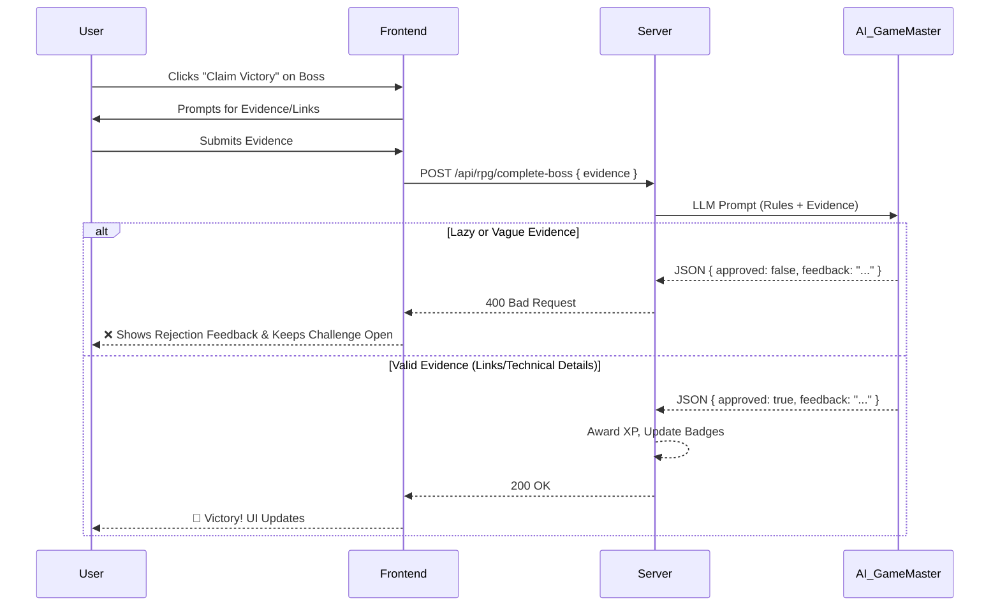
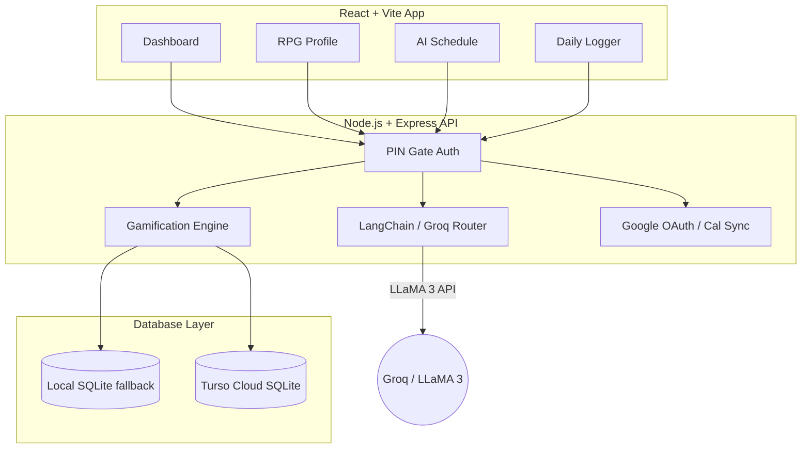

# ⚡ Growth Radar (RPG & Gamification Engine)

A highly secure, AI-powered personal productivity and habit-tracking system. Growth Radar helps you track your daily activities across custom dimensions, maintain streaks, and uses a strict AI Game Master to level up your life like an RPG.

## 🚀 Features

- **Personal Dimensions & Radar:** Track any area of your life (e.g., Coding, Fitness, Career, Social). The UI visualizes your current baseline vs your "expected" AI-calibrated score on a beautiful radar chart.
- **Daily Logging & 180-Day Heatmap:** Keep yourself accountable with daily activity logging. View your consistency on a massive 180-day GitHub-style contribution grid with color-coded intensities.
- **AI Schedule Generator:** Powered by Llama 3 (via Groq), it generates highly personalized daily schedules by analyzing your recent activity gaps and daily goals.
- **Google Calendar Sync:** Instantly export your AI-generated schedule directly to your Google Calendar.
- **PIN Protection:** The entire interface and backend API are locked behind a secure PIN gate.
- **Data Export:** Download your entire history in CSV or Excel format.

---

## 🎮 The Gamification Engine

Growth Radar transforms daily habits into an immersive RPG.

1. **Global Character Progression:** Earning XP automatically levels up your global character and upgrades your Title (e.g., *Novice → Apprentice → Architect*).
2. **Dimension-Specific Leveling:** Every dimension tracks its own XP, Level, and Bonus multipliers independently.
3. **Skill Trees:** Define custom learning paths (nodes) for each dimension. Completing a skill node instantly grants XP.
4. **Boss Fights & Side Quests:** Periodically, you will unlock Boss Fights or discover randomly generated Side Quests based on your weaknesses.
5. **The AI Game Master:** You cannot simply click "complete". An AI Judge strictly evaluates your submitted evidence (GitHub links, deployed URLs, or detailed technical explanations). Lazy submissions are rejected.

### 🧠 Game Master Workflow



---

## 🏗️ System Architecture



---

## 🛠️ Tech Stack

- **Frontend:** React + Vite, Recharts, Vanilla CSS (Custom Design System)
- **Backend:** Node.js + Express
- **Database:** LibSQL / Turso Cloud (with local SQLite fallback)
- **AI Integration:** Langchain + Groq SDK (Temperature 0.1 for Game Master, 0.7 for Creativity)
- **Security:** Helmet, express-rate-limit, HTTP-only Auth Cookies

---

## 💻 Running Locally

### Prerequisites
1. Node.js (v18+)
2. API Keys for Groq and Google OAuth.

### Setup
1. Clone the repository.
2. Install dependencies:
   ```bash
   npm install
   ```
3. Create a `.env` file in the `server` folder with the following keys:
   ```env
   # Security
   APP_PIN=976312
   PORT=3001
   
   # AI Services
   GROQ_API_KEY=your_groq_api_key
   
   # Google OAuth (For Calendar Sync)
   GOOGLE_CLIENT_ID=your_google_client_id
   GOOGLE_CLIENT_SECRET=your_google_client_secret
   GOOGLE_REDIRECT_URI=http://localhost:3001/api/calendar/callback
   
   # Database (Optional - falls back to server/data/growth.db)
   TURSO_DB_URL=libsql://your-turso-url.turso.io
   TURSO_AUTH_TOKEN=your_turso_token
   ```

4. Start the development server (runs both frontend and backend concurrently):
   ```bash
   npm run dev
   ```

## ☁️ Deployment

This repository includes a `render.yaml` Blueprint for 1-click deployment on [Render](https://render.com). 

1. Connect this repository to your Render account as a Web Service.
2. Ensure you have properly set your environment variables (especially `APP_PIN`).
3. The database migration scripts run automatically on startup to adapt to your production Turso database without overwriting existing data.
4. Update your Google Cloud Console OAuth settings to include your live Render URL as an authorized redirect URI!

---
*Built with ❤️ and Antigravity AI*
