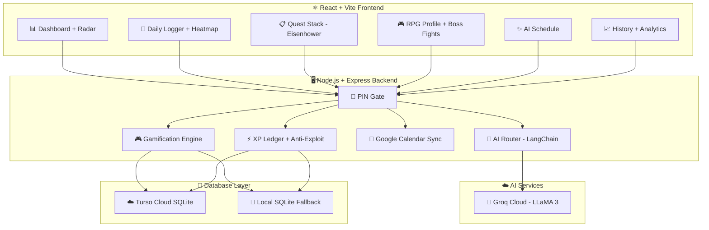
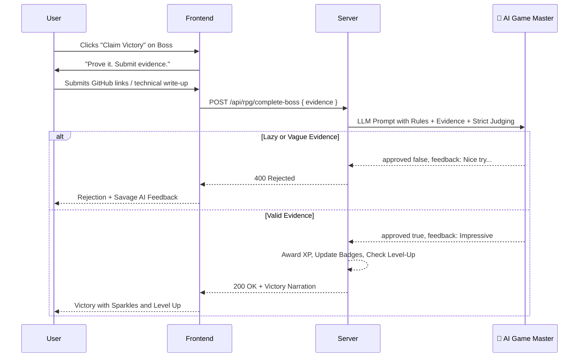

# 🎮⚡ Growth Radar — The World's Most Over-Engineered To-Do List

> *"I could have used Notion. Instead, I built an entire RPG with boss fights, an AI Game Master, skill trees, and an Eisenhower Matrix... just to remind myself to watch a YouTube tutorial."*

[](https://growth-radar.onrender.com)
[](#)
[](#)
[-fbbf24?style=for-the-badge)](#)

---

## 🤔 What Is This?

Growth Radar is a **full-stack personal growth tracking system** that transforms mundane tasks like "watch a podcast" and "read documentation" into an immersive RPG experience — complete with XP, leveling, boss fights, AI-judged challenges, side quests, skill trees, a priority queue with Eisenhower Matrix, AI-generated daily schedules, Google Calendar sync, radar charts, 180-day heatmaps, and streak tracking.

All of this engineering, infrastructure, and AI integration exists to serve **exactly one user**: me.

---

## ✨ Feature List (Yes, All of These Are Real)

### 📊 The Dashboard
- Interactive **Radar Chart** visualizing your life across custom dimensions (Coding, Fitness, Communication, etc.)
- Category filtering (Technical, Creative, Health, Career, Social)
- Full history tracking with timestamped snapshots

### 📝 Daily Logger
- Log activities with dimension tagging, duration tracking, and completion status
- **180-day GitHub-style contribution heatmap** with color-coded intensity
- Streak tracking with 7-day multiplier bonuses
- Auto-XP awards on task completion (calculated by duration difficulty tier)

### 📋 Priority Quest Stack (Eisenhower Matrix)
- **4-lane priority system**: 🔴 Do First → 🟡 Schedule → 🟠 Delegate → 🔵 Backlog
- **3 status tabs**: To Do → On Going → Completed
- Auto-sort by due date, manual reordering with ⬆️⬇️ buttons
- Type-based XP rewards: 🏆 Certification (+50 XP), 🛠️ Project (+30 XP), 🎯 Goal (+20 XP), 📝 Task (+15 XP), 🎧 Podcast (+10 XP), 📚 Course (+10 XP)
- Start Bonus (+5 XP just for beginning a task)
- Daily streak bonus (+20 XP for completing 3+ tasks/day)
- **One-way sync to Daily Logs** with `xp_awarded` flag to prevent the infinite XP exploit I accidentally created and then had to patch

### 🎮 The RPG Engine (This Is Where It Gets Unhinged)

#### Character Progression
- Global XP → Level → Title system (*Novice → Apprentice → Journeyman → Architect → Grandmaster → Transcendent → ∞ Ascended*)
- Per-dimension XP, levels, and bonus multipliers
- Beautiful animated character card with level-up celebrations and sparkle effects

#### 🐉 Boss Fights
- AI-generated boss encounters tied to your weakest dimensions
- **3 tiers**: Mini Boss (200 XP), Major Boss (500 XP), Final Boss (1000 XP)
- You submit evidence of your work (GitHub links, deployed URLs, technical write-ups)
- An **AI Game Master (LLaMA 3 via Groq, temperature 0.1)** strictly judges your submission
- Lazy submissions get rejected with savage feedback. You cannot cheat.

#### 🗺️ Side Quests
- AI discovers random side quests based on your recent activity patterns
- Weekly completion bonuses for finishing 3+ quests
- Auto-targets your lowest-performing dimensions

#### 🌳 Skill Trees
- Define custom learning path nodes per dimension
- Completing a node grants instant XP (+25)
- Visual node map with completion tracking

### ✨ AI Schedule Generator
- Powered by **LLaMA 3 (Groq SDK)** analyzing your recent logs and gap areas
- Generates a full daily schedule with time blocks, activities, and dimension tags
- One-click **Google Calendar sync** via OAuth 2.0

### 📈 History & Analytics
- Score change timeline with delta tracking
- XP transaction log with source attribution
- Daily XP summary charts

### 🔒 Security
- PIN-gated authentication (frontend + backend)
- HTTP-only secure cookies
- Helmet security headers
- Express rate limiting
- CORS lockdown

---

## 🏗️ Architecture



### 🧠 AI Game Master Workflow



---

## 🛠️ Tech Stack

| Layer | Technology |
|-------|-----------|
| **Frontend** | React 18 + Vite 6, Recharts, Vanilla CSS (Custom dark-mode design system) |
| **Backend** | Node.js + Express 5, 1090+ lines of API logic |
| **Database** | LibSQL / Turso Cloud SQLite (with local fallback) |
| **AI** | LangChain + Groq SDK (LLaMA 3) — Temperature 0.1 for judging, 0.7 for creativity |
| **Auth** | PIN gate + HTTP-only cookies + Helmet + Rate Limiting |
| **Calendar** | Google OAuth 2.0 + Calendar API v3 |
| **Deployment** | Render (Web Service + Static Site) |

### By The Numbers
- **11 React components** (47KB for RPGProfile alone)
- **40KB+ database layer** with 12 tables and migration scripts
- **43KB+ API server** with 30+ endpoints
- **5 AI-powered features** (Schedule, Boss Fights, Side Quests, Victory Narrations, Challenge Judging)
- **1 user**

---

## 📸 Screenshots

> *Add your screenshots here — Dashboard, RPG Profile, Boss Fight, Quest Stack, AI Schedule*

---

## 💻 Running Locally

### Prerequisites
- Node.js v18+
- A Groq API key ([free at console.groq.com](https://console.groq.com))
- (Optional) Google OAuth credentials for Calendar sync
- (Optional) Turso database URL for cloud persistence

### Setup

```bash
# Clone the repo
git clone https://github.com/KedarJ10-design/growth-radar.git
cd growth-radar

# Install dependencies
npm install
```

Create `server/.env`:

```env
# Security
APP_PIN=******
PORT=3001

# AI Services
GROQ_API_KEY=your_groq_api_key

# Google OAuth (Optional - for Calendar Sync)
GOOGLE_CLIENT_ID=your_google_client_id
GOOGLE_CLIENT_SECRET=your_google_client_secret
GOOGLE_REDIRECT_URI=http://localhost:3001/api/calendar/callback

# Database (Optional - falls back to local SQLite)
TURSO_DB_URL=libsql://your-turso-url.turso.io
TURSO_AUTH_TOKEN=your_turso_token
```

```bash
# Start dev server (frontend + backend concurrently)
npm run dev

# Open http://localhost:3000
# Enter PIN: ******
```

---

## ☁️ Deployment

This repo includes a `render.yaml` Blueprint for 1-click deployment on [Render](https://render.com).

1. Connect the repository to Render as a Web Service
2. Set all environment variables (especially `APP_PIN` and `GROQ_API_KEY`)
3. Database migrations run automatically on startup — **zero data loss**
4. Update Google Cloud Console with your live Render URL as an authorized redirect URI

---

## 🧠 The Philosophy (If You Can Call It That)

This project exists because I genuinely convinced myself that the reason I wasn't watching educational podcasts was because I didn't have a **boss fight system with AI-judged evidence submission** to motivate me.

Instead of opening YouTube, I spent weeks building:
- A full RPG progression system with 7 character tiers
- An AI Game Master that roasts you for lazy submissions
- An Eisenhower Matrix with anti-exploit XP protection
- A 180-day heatmap for a database that will never have 180 days of data
- Google Calendar integration so my over-engineered schedule can sync to... another app I don't check

The to-do list problem has been solved since pen and paper. I chose violence.

---

## 📄 License

MIT — Because even useless software deserves freedom.

---

*Built with mass amounts of unnecessary engineering*
